<div align="center">

<picture>
  <source media="(prefers-color-scheme: dark)" srcset=".github/assets/banner-dark.svg">
  
</picture>

**Use [push-in/pam-native-ui](https://github.com/push-in/pam-native-ui): it is where PAM Native UI is developed and released.**<br>
This repository holds the PAM Native UI 1.0.7 Composer distribution (`VERSION` 1.0.7). Packagist's `pushinbr/pam-native-ui` now resolves from push-in/pam-native-ui, which ships the newer releases.


[](https://github.com/push-in/pam-native-ui-php/actions/workflows/verify.yml)
[](LICENSE)

[Install](#install) · [Contents](#contents) · [Docs](#docs) · [Current repository](https://github.com/push-in/pam-native-ui)

</div>

<a id="install"></a>
## <picture></picture> Install

Install the current package inside a PAM Native project:

```sh
pam init my-app --template native-ui
cd my-app
pam dev
```

Or add it to an existing PAM Native project with `pam composer require pushinbr/pam-native-ui`. See the [PAM Native UI README](https://github.com/push-in/pam-native-ui#readme).

<a id="platform-support"></a>
## <picture></picture> Platform support

| Platform | Support | Notes |
| --- | --- | --- |
| Android | API 26+ | From this repo's `pam-native.plugin.json` (1.0.7) |
| iOS | 15.0+ | From `pam-native.plugin.json` |
| PAM Native | 1.0.0 to < 2.0.0 | From `pam-native.plugin.json`; PHP 8.5+ |

<a id="contents"></a>
## <picture></picture> What is in this repository

The source of the 1.0.7 distribution: the PHP library (`src/`), the Android (`android/`) and iOS (`ios/`, `Package.swift`) renderers, the kitchen-sink example, tests, benchmarks and documentation (`docs/`). The README of that release is preserved verbatim in **[docs/distribution-readme.md](docs/distribution-readme.md)**; nothing was removed. Changes are listed in [CHANGELOG.md](CHANGELOG.md).

Issues and contributions go to [push-in/pam-native-ui](https://github.com/push-in/pam-native-ui/issues).

<a id="docs"></a>
## <picture></picture> Docs

- [Previous README (1.0.7 distribution)](docs/distribution-readme.md)
- [PAM Native UI (current)](https://github.com/push-in/pam-native-ui)
- [PAM Native overview](https://push-in.github.io/pam-docs/native/overview/)
- [Changelog](CHANGELOG.md)

<a id="pam-ecosystem"></a>
## <picture></picture> Part of the PAM ecosystem

<p align="center"><picture>
  <source media="(prefers-color-scheme: dark)" srcset=".github/assets/pam-wordmark-dark.svg">
  
</picture></p>

PAM runs PHP natively on servers, desktops and phones. This repository is one piece of it.

| [**PAM**](https://github.com/push-in/pam) | [**PAM Desktop**](https://github.com/push-in/pam-desktop) | [**PAM Native**](https://github.com/push-in/pam-native) | [**Ecosystem**](https://github.com/push-in/pam#ecosystem) |
| --- | --- | --- | --- |
| the runtime and CLI | native desktop apps in PHP | native Android and iOS apps in PHP | every official package and plugin |

<sub>Docs: [push-in.github.io/pam-docs](https://push-in.github.io/pam-docs/introduction/) · [Issues](https://github.com/push-in/pam-native-ui-php/issues)</sub>

<p align="center"><sub><a href="LICENSE">Apache-2.0</a>, see also <a href="LICENSING.md">LICENSING.md</a> · Made in Brazil by Pushin</sub></p>
